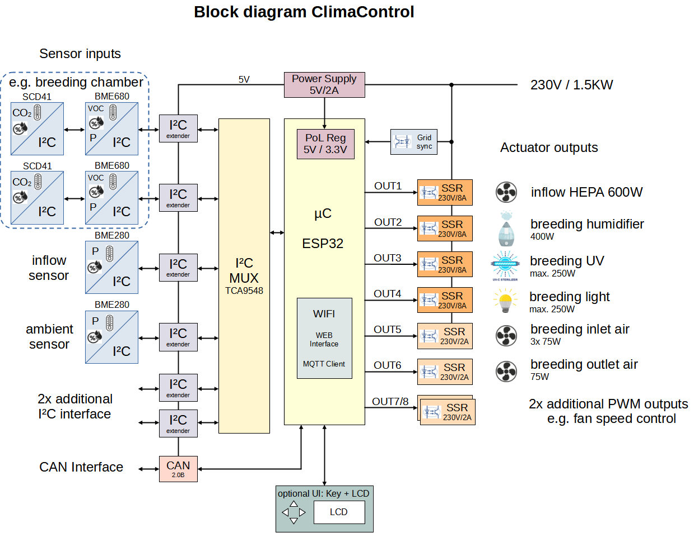

# Climatronic

> Firmware for TronicPunks Climate Control Unit

## Climatronic Overview
The Climatronic is an electronic module for monitoring and controlling indoor climate conditions.
Up to twelve sensors can be connected via a bus system to measure environmental parameters such as temperature, humidity, air pressure, and CO₂ concentration.
Eight outputs are available to control actuators for ventilation, humidification, heating, or cooling.

### Features

- six independant I2C based bus system with range extender
- four 800W power AC outputs with half/full wave control
- four 200W AC outputs with half/full wave control
- optional digital PWM output with 2 KHz PWM frequency and 0.1% duty cycle resolution
  e.g. for fan speed control
- tiny web interface to read status information and setup control parameters
- MQTT support to provide measurement and output values for data logging and remote control

#### MQTT

MQTT is disabled until a broker URI is configured in `idf.py menuconfig` under
**Climatronic MQTT**. Configure the broker URI, optional username/password,
topic prefix, and publish interval there. Use `mqtts://` for TLS; the default
ESP certificate bundle is used for broker certificate validation. Broker
credentials are stored in the local `sdkconfig`; do not commit a configured
`sdkconfig` containing real secrets.

With the default prefix `climatronic`, remotely readable sensors publish
JSON values to `climatronic/sensors/<index>/state`. Read-enabled outputs
publish their current PWM value (0–1000) to
`climatronic/outputs/<channel>/state`. Write-enabled outputs subscribe to
`climatronic/outputs/<channel>/set`; send a decimal integer from 0 to 1000.
Indices and channels are zero-based. Remote output commands are accepted only
when the physical output selector is in AUTO mode. Configure the Read and Write
flags per sensor/output in the web interface. The ESP32 is an MQTT client; the
broker itself runs separately.

#### Important links:
For more information, please refer to:

- [git repository](https://github.com/TronicPunk/climatronic)

---
